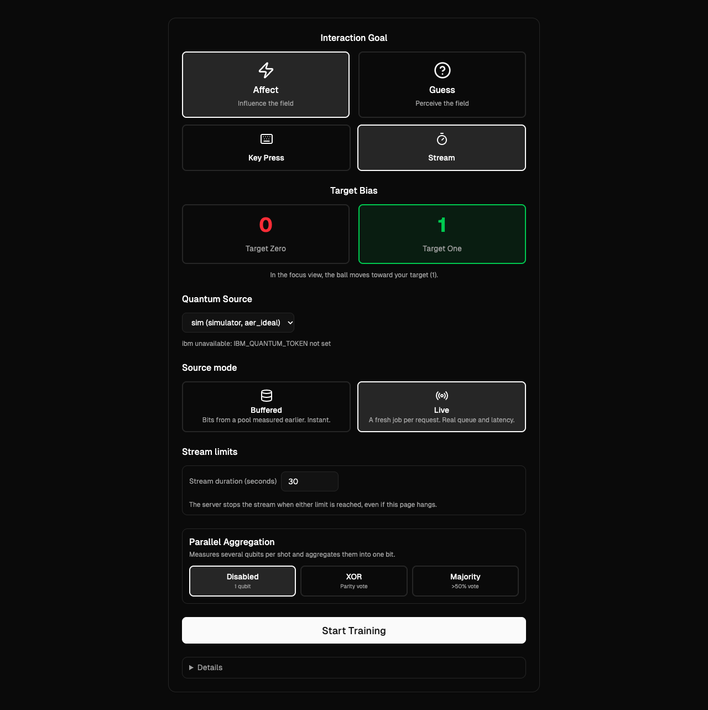
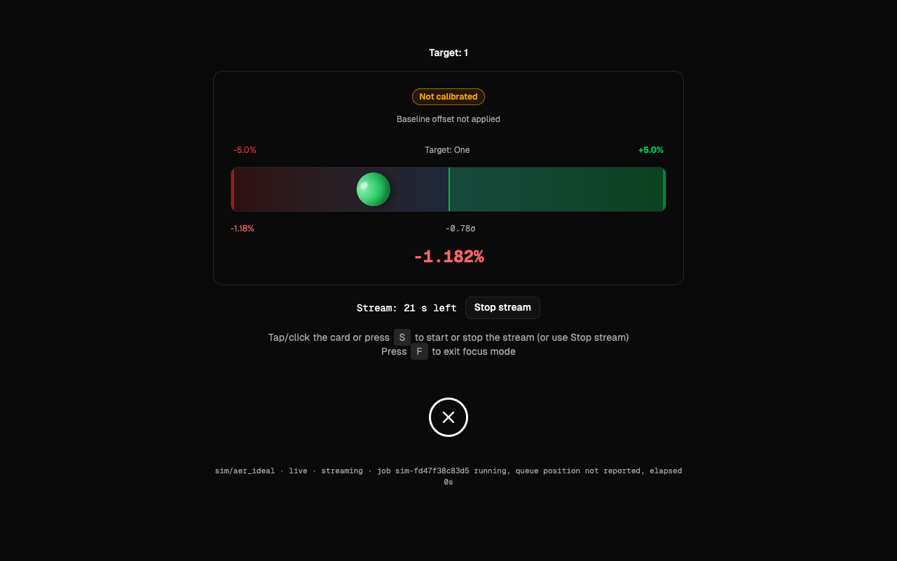

# Quantum Bias Lab

A one-process web app that draws random bits from quantum circuits (a Hadamard on each of `n`
qubits, then measure) and shows whether the bits are biased. It runs on a local simulator
(`sim`, qiskit-aer, no account needed) or on a real IBM Quantum QPU (`ibm`, with your own API
key). You can stream bits, press a key for one bit, play Predict (guess, then measure) and
Perceive (hidden bit, then reveal), and watch a running bias and sigma. Every bit carries its
provenance (job id, backend, live or buffered), and statistics are kept per mode so buffered
bits never pass as live ones. Errors are shown as they are: nothing falls back to the
simulator, to a pool, or to made-up bits.





## Features

- Two providers: `sim` (always available) and `ibm` (enabled when a token is configured).
- Buffered mode (bits from a pool of earlier measurements) and Live mode (a fresh job per
  request, with its real state shown).
- Affect (Key Press or Stream, with a target bit) and Guess (Predict, Perceive) interactions.
- Parallel aggregation: none, XOR (parity) or Majority of several qubits.
- Server-enforced stream limits (duration, and IBM job count) so a stream cannot run on and bill you.
- Cost ceilings for IBM usage, an estimate of QPU seconds, and a job list.
- No Docker, Node, database or CDN needed to run; the UI works offline.

## Quickstart

Needs Python 3.10 to 3.13 (uv fetches one if missing).

macOS / Linux:

```sh
curl -LsSf https://astral.sh/uv/install.sh | sh
uv sync
uv run quantum-lite --open
```

Windows PowerShell:

```powershell
powershell -ExecutionPolicy ByPass -c "irm https://astral.sh/uv/install.ps1 | iex"
uv sync
uv run quantum-lite --open
```

Run these in the repository folder, and open a new terminal after installing uv if `uv` is not
found. The app serves on http://127.0.0.1:8765/. Without a token only `sim` is available.
Stop it with `Ctrl+C`. Let running jobs finish first (see `/api/jobs`): a job still running when
the server stops does not reach any pool, and on `ibm` it is still billed.

## Using it

**Setup page.** Pick an Interaction Goal: *Affect* (Key Press or Stream, with a Target Bias of
0 or 1) or *Guess* (Predict, Perceive). Pick the Quantum Source (`sim`, or `ibm`, greyed out
with its reason when no token is set), the Source mode, and Parallel Aggregation (Disabled with
1 qubit, XOR with 1 to 16 qubits, Majority with an odd count from 1 to 15). Start Training opens
the focus view.

**Buffered vs Live.**

| Mode | Where bits come from | What it shows |
|---|---|---|
| Buffered | A pool of real measurements fetched earlier by one or more large jobs, consumed in order, one shot at a time, never reused. | The bits are real measurements, but taken before you asked. Predict marks them `measured before guess`. Instant. |
| Live | A fresh job per interaction and per stream cycle; the UI shows its state (submitting, queued, running, elapsed; queue position only when IBM reports it). | The bit did not exist until after your action. Predict submits the job after your guess arrives. Slow on a real QPU: each job queues. |

**Prefetch.** Buffered mode needs a pool. Pools are per provider, device and qubit count. In
Buffered mode the setup page shows the unconsumed shots and a Prefetch button, or use the CLI:
`uv run quantum-lite prefetch --provider sim --qubits 5 --shots 20000`. Pools live in
`.data/pools/` and survive restarts. An empty pool in Buffered mode is an error (409
`pool_empty`), not a reason to go live.

**Stream limits.** With Stream chosen, **Stream duration** (seconds, default 30, 1 to 3600) says
how long a stream run may last. For `ibm`, **Max IBM jobs** (default 5, 1 to 1000) caps the jobs one
stream run may cause, and the estimated QPU seconds for that many jobs are shown next to it. The
server enforces both, even if the page hangs. Reaching a limit is not an error: the bar says
"Stream stopped: N s limit reached" or "N job limit reached".

**Stop.** The **Stop stream** button, or `S` / `SPACE`, stops a stream. A live job already
submitted cannot be recalled: it finishes, counts, and its bits are added to that device's pool
instead of the live statistics. In buffered mode, shots already being taken from the pool when
you stop are still shown and counted as the stream's last batch.

**Predict / Perceive.** In Predict you guess 0 or 1 (`0` / `1` keys), then the bit is measured.
In Perceive the bit is measured and hidden, you guess, then it is revealed. The focus view shows
hits, hit rate and the sigma of the hits.

**Provenance.** The footer line shows provider/backend, buffered or live, and the latest job
id. Each bit or batch carries `job_id`, `source`, `provider`, `backend` and `measured_at`;
statistics are kept per mode segment and for the whole session.

| Key | Action |
|---|---|
| `SPACE` | Request a bit (Key Press), start or stop the stream (Stream), request the hidden bit (Perceive) |
| `S` | Start or stop the stream |
| `0` / `1` | Guess (Predict; Perceive after the bit is requested) |
| `F` or `Esc` | Leave the focus view; a running stream is stopped |

## Running on a real IBM QPU

1. Create an IBM Quantum account at https://quantum.cloud.ibm.com and create an API key.
2. Copy `.env.example` to `.env` and set `IBM_QUANTUM_TOKEN=<your key>` (`QISKIT_IBM_TOKEN`
   also works). Set `IBM_QUANTUM_INSTANCE` to your instance CRN (or name) if your account has
   several. The channel defaults to `ibm_quantum_platform`.
3. Pin the device with `IBM_BACKEND`, for example `IBM_BACKEND=ibm_marrakesh`. A pool belongs
   to one device; with `IBM_BACKEND` unset each process picks the least busy real device on
   its own, and may not find the pool a prefetch filled.
4. Restart `uv run quantum-lite`. The `ibm` source is now enabled.

Nothing contacts IBM at startup. The device is resolved on first use, and every QPU job is one
you caused, listed in `/api/jobs`. The token goes straight to `QiskitRuntimeService`;
`save_account` is never called, so nothing is written to `~/.qiskit`, and the token is not
logged or returned by any endpoint.

**Cost.** IBM's Open plan gives 10 QPU minutes (600 s) per rolling 28 days. The app estimates a
job at `2 s + 0.00035 s x shots` (an estimate, not a measurement): a 20000-shot prefetch is
about 9 s, a 1-shot live job about 2 s. Controls:

- `IBM_MAX_SHOTS_PER_JOB`, `IBM_MAX_TOTAL_SHOTS`, `IBM_MAX_JOBS`: ceilings per job and per process.
  They reset on restart and know nothing of what your account already spent; check the IBM dashboard.
- The per-stream limits above (Stream duration and Max IBM jobs), required for every `ibm` session.
- `auto_refill` (an API session flag that refills a low pool) is sim only: `ibm` refuses it
  (400 `auto_refill_ibm`), so an IBM pool is only filled by an explicit prefetch.
- A live stream submits one job per cycle, each costing at least the 2 s base. Prefer Buffered
  for streaming and keep Live for single-bit interactions.
- After Stop, at most the one job in flight finishes and is billed.

A typical session: prefetch once (`uv run quantum-lite prefetch --provider ibm --qubits 5 --shots 20000`,
which blocks until the job finishes and prints the device, job id and estimated QPU seconds),
then run Buffered sessions as often as you like.

## Configuration

Environment variables, or a `.env` file in the project root (the process environment wins over
the file). Bad values (non-numbers, values below 1, unknown `SIM_NOISE`) stop the app at
startup with the reason.

| Variable | Default | Meaning |
|---|---|---|
| `IBM_QUANTUM_TOKEN` (alias `QISKIT_IBM_TOKEN`) | unset | API key. Unset: `ibm` is listed as not configured. |
| `IBM_QUANTUM_INSTANCE` | unset | Optional instance CRN or name. |
| `IBM_QUANTUM_CHANNEL` | `ibm_quantum_platform` | `ibm_quantum_platform` or `ibm_cloud`. Anything else stops the app. |
| `IBM_BACKEND` | unset | Fixed device name, e.g. `ibm_marrakesh`. Unset: least busy operational real device, resolved once per process. |
| `IBM_MAX_SHOTS_PER_JOB` | `20000` | Per-job shot ceiling. Above it: 400. |
| `IBM_MAX_TOTAL_SHOTS` | `200000` | Per-process shot ceiling over all IBM jobs. Above it: 429. |
| `IBM_MAX_JOBS` | `100` | Per-process IBM job count ceiling. Above it: 429. |
| `SIM_NOISE` | `none` | `none` = ideal simulator; `fake` = noise model of a fake IBM device. |
| `SIM_LATENCY_SECONDS` | `0` | Artificial delay per simulator job, so Live mode can be shown without a key. Job events say `simulated_latency: true`. |
| `QL_DATA_DIR` | `.data/` in the project root | Where pools are stored. |

## CLI

```sh
uv run quantum-lite [--env-file F] [serve] [--host H] [--port P] [--open]
uv run quantum-lite [--env-file F] prefetch [--provider sim|ibm] [--qubits 5] [--shots 20000]
uv run quantum-lite [--env-file F] pools
```

`serve` is the default command. `--host` defaults to `127.0.0.1`, `--port` to `8765`; `--open`
opens the browser; `--env-file` names a `.env` file instead of the default. `pools` lists the
pools on disk. `prefetch` fills a pool and exits; qubits are 1 to 16.

## HTTP API

The app is a FastAPI service with JSON endpoints under `/api`; errors are
`{"error": code, "detail": message}`. The schema is served at `/openapi.json`. The interactive
Swagger page `/docs` is disabled (it loads assets from a CDN and the app works offline), so
point a client or a Swagger viewer at `/openapi.json`.

## Running tests

```sh
uv sync
uv run pytest
```

Needs Node.js on `PATH` for the UI logic tests. The suite runs with no IBM access (IBM code is
tested against fakes), ignores your `.env` and any `IBM_*`, `SIM_*`, `QL_*` variables, and treats
warnings as errors. `tests/test_live_ibm.py` is skipped unless `QL_LIVE_IBM=1` and a token are
set; it submits a real job and uses real QPU time, so run it deliberately:

```sh
QL_LIVE_IBM=1 uv run pytest tests/test_live_ibm.py
```

## Troubleshooting

- **Port in use**: run `uv run quantum-lite --port 8766`.
- **`ibm` disabled, "IBM_QUANTUM_TOKEN not set"**: no token reached the app. Check `.env` in the
  project root or the environment. There is no fallback to the simulator.
- **409 `pool_empty`**: Buffered mode with too few unconsumed shots for that provider, device and
  qubit count. Prefetch for the same provider and qubits first, or use Live. For `ibm` the pool
  is also keyed by device: set `IBM_BACKEND` to the device the prefetch printed
  (`uv run quantum-lite pools` shows what is on disk) and restart.
- **Stream stopped by itself**: a limit was reached (`stream.stopped_reason` is
  `limit_seconds: ...` or `limit_jobs: ...`, not an error; press `S` for a new run), the page was
  closed or reloaded (the last event listener left, so a forgotten tab cannot keep submitting
  jobs), or an error, shown in red.
- **A new live stream shows no batch at first**: a stopped stream's live job has not finished yet
  (it cannot be recalled). The new stream waits for it before it submits its own job, so a session
  never has two stream jobs running; if the stream duration runs out while it waits, the stream
  stops with `limit_seconds`. The same holds after switching a running stream to Live. Switching
  to Buffered while it waits submits no further live job; pool batches follow once that job finishes.
- **400 `invalid_stream_seconds` / `invalid_stream_max_jobs`**: `stream_seconds` is missing or
  outside 1 to 3600, or an `ibm` session has no `stream_max_jobs` (1 to 1000). The API has no default.
- **IBM queue is slow**: live jobs wait in IBM's queue, possibly minutes. Use Buffered for streaming.
- **400 / 429 from IBM paths**: a ceiling was hit (`IBM_MAX_SHOTS_PER_JOB`, `IBM_MAX_TOTAL_SHOTS`,
  `IBM_MAX_JOBS`). Raise it deliberately in `.env`; counts reset on restart.
- **502 `provider_error`**: IBM or the simulator failed; the message is the raw error.
- **Wrong Host**: when bound locally the app answers only to `127.0.0.1` and `localhost`
  (blocks DNS-rebinding pages). Browse to `http://127.0.0.1:8765/`.
- **Deprecation warnings**: qiskit-aer 0.17.2 and qiskit-ibm-runtime 0.44.1 read properties that
  qiskit 1.4.5 deprecates. The versions are pinned and the test suite ignores exactly those
  messages; they have no behavioural effect.
- **Windows**: run commands in a new terminal after installing uv. The `-ExecutionPolicy ByPass`
  in the install line applies to that one command only. Data is under `.data\`.

## Security

Put the token in `.env` (gitignored, as are `.env.*` except `.env.example`) and never commit it.
The app has no authentication and binds `127.0.0.1` by default; passing any other `--host`
prints a warning, because anyone who can reach that address can use your session and your IBM
budget.

## License

MIT, see [LICENSE](LICENSE). The bundled Geist fonts in `src/quantum_lite/static/fonts/` are
licensed under the SIL Open Font License 1.1, see
[LICENSE.TXT](src/quantum_lite/static/fonts/LICENSE.TXT).
